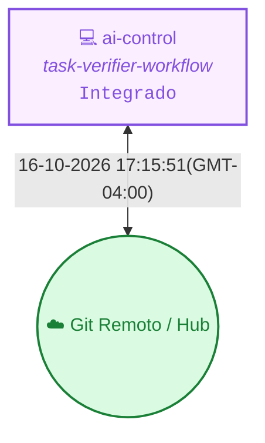

<!-- README.md | Atualizado em: 16-10-2026 17:18:43(GMT-04:00) -->

# 🧠 Painel de Contexto — kit_src

> **Vitalia Kit v0.5.0 — Ledger de Memória Persistente e Orquestração Multi-Máquina.**  
> Este repositório armazena o histórico distribuído, aprendizados consolidados e o controle de concorrência das sessões de trabalho do framework Vitalia.

---

## 📡 Topologia de Shards & Sincronização

---

## 🖥️ Máquinas e Status Atual

<table>
  <thead>
    <tr>
      <th align="left">Máquina / ID</th>
      <th align="left">Tarefa Atual</th>
      <th align="center">Ambiente</th>
      <th align="center">Status</th>
      <th align="left">Último Sync</th>
      <th align="left">Próximo Passo (P0)</th>
    </tr>
  </thead>
  <tbody>
    <tr>
      <td><strong>ai-control</strong> (<code>17a6f667</code>)</td>
      <td>task-verifier-workflow</td>
      <td align="center"></td>
      <td align="center">● Concluído</td>
      <td>16-10-2026 17:15:51(GMT-04:00)</td>
      <td><strong>Testar localmente na próxima sessão o funcionamento ponta a ponta do kit e workflows no repositório, validando o novo fluxo antes de qualquer submissão ao GitHub.</strong></td>
    </tr>
  </tbody>
</table>

---

## 🎯 Sessão Ativa em Destaque

- **Estação Ativa:** `ai-control` (`17a6f667`)
- **Tarefa em Execução:** task-verifier-workflow
- **🎯 Próximo Passo Prioritário (P0):** `Testar localmente na próxima sessão o funcionamento ponta a ponta do kit e workflows no repositório, validando o novo fluxo antes de qualquer submissão ao GitHub.`
- **Última Sincronização:** `16-10-2026 17:15:51(GMT-04:00)`

---

## 📚 Histórico, Decisões & Guard Rails

<strong>🔍 Clique para expandir o Histórico Completo de Sessões</strong>

 

| Data / Hora | Estação (ID) | Tarefa Executada | Próximo Passo (P0) |
| :--- | :--- | :--- | :--- |
| 16-10-2026 17:15:51(GMT-04:00) | `ai-control (17a6f667)` | task-verifier-workflow | `Testar localmente na próxima sessão o funcionamento ponta a ponta do kit e workflows no repositório, validando o novo fluxo antes de qualquer submissão ao GitHub.` |
| 12-10-2026 21:23:00(GMT-04:00) | `ai-control (17a6f667)` | sdd-judge-robustness | `Release v0.6.1 ou início de novo ciclo de feature com sdd_judge robusto ativo` |

<strong>⚖️ Clique para expandir as Decisões Arquiteturais Consolidadas</strong>

 

| Máquina (ID) | Decisão Arquitetural | Impacto / Racional |
| :--- | :--- | :--- |
| `17a6f667` | **[ea9ce99b]** `ARQUITETURA` Governança graduada de avisos onde WARN com warn_severity EXTREME é elevado programaticamente para BLOCK (exit code 1). | Impede que violações severas de arquitetura passem despercebidas como simples avisos cosméticos. |
| `17a6f667` | **[8a46c497]** `ARQUITETURA` Implementação do TasksEvaluator em modo 1-a-1 atômico com varredura completa e tabela consolidada de suggested_fix. | Elimina lost-in-the-middle e complacência autorregressiva, entregando lista completa de correções de uma só vez. |
| `17a6f667` | **[84ced170]** `ARQUITETURA` Adoção do qwen2.5:3b como OLLAMA_REASONING_MODEL padrão no ambiente local com GTX 1060 6GB. | Consome apenas 2.9 GB de VRAM, opera 100% na GPU sem CPU offloading e funciona no Ollama 0.5.12 sem erro de tensores. |

<strong>🛡️ Clique para expandir os Guard Rails de Grounding e Domínios</strong>

 

| Arquivo de Regras | Status | Domínios Monitorados | Pendentes de Curadoria HITL |
| :--- | :---: | :--- | :---: |
| `grounding-domains.yaml` (Global) | ✅ Ativo | `llm_models`, `python_packages`, `external_apis`, `security_practices`, `regulations`, `cloud_services`, `scientific_claims` | — |
| `grounding-domains-local.yaml` (Projeto) | ✅ Sincronizado | Domínios locais específicos do workspace | `0 pendências` |

---

Painel gerado automaticamente pelo motor de contexto do Vitalia Kit (<code>vitalia_context_engine.py --action consolidate</code>).
